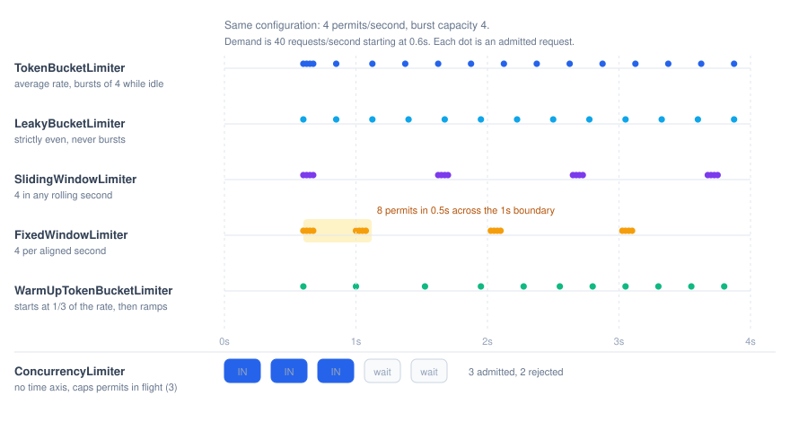

<div align="center">


# java-limiter · 疾限

**Lock-free rate limiting for Java 8+ — six algorithms in one 18 KB jar, zero runtime dependencies, no background threads.**

<a href="https://limiter.wordtk.com"></a>

<br/>


<br/><br/>

🇺🇸 **English** &nbsp;·&nbsp; [🇨🇳 简体中文](README.zh-CN.md)

<br/>



</div>

> **The same 4 permits per second, six different admission patterns.** A token bucket spends a burst
> and then settles; a leaky bucket paces evenly; a sliding window refuses the boundary trick; a fixed
> window hands out twice the rate across a clock tick; a warm-up limiter starts cold; a concurrency
> limiter ignores the clock entirely. One interface, one jar, nothing extra on your classpath.

---

## Table of contents

| | |
| --- | --- |
| [What it does](#what-it-does) | [Install](#install) |
| [Quick start](#quick-start) | [Pick an algorithm](#pick-an-algorithm) |
| [Common usage](#common-usage) | [Documentation](#documentation) |
| [Build from source](#build-from-source) | [License](#license) |

---

## What it does

- **Zero runtime dependencies** — only the JDK. No framework, no logging binding, no JSON library, no
  Redis client. Nothing to exclude from your build, no version conflicts to resolve.
- **Lock-free** — one atomic read plus at most one compare-and-set per request. No mutex, no blocking,
  no lock contention on the fast path.
- **No background threads** — the rate is derived from `System.nanoTime()` when a request arrives, so an
  idle limiter costs no CPU, starts nothing, and never grows.
- **No allocations per call** — a limiter holds a fixed number of `long`s, whatever the traffic is.
- **Java 8 bytecode** — class file version 52 with `Automatic-Module-Name: io.github.onblog.limiter`;
  the same artifact runs on Java 8 through 25, on the classpath or the module path.
- **Six algorithms behind one interface** — swap a token bucket for a rolling window without touching
  the call sites, and no algorithm is a relabelled copy of another.

## Install

```xml
<dependency>
    <groupId>io.github.onblog</groupId>
    <artifactId>java-limiter</artifactId>
    <version>1.0.0</version>
</dependency>
```

```groovy
implementation 'io.github.onblog:java-limiter:1.0.0'
```

## Quick start

```java
import io.github.onblog.limiter.RateLimiter;
import io.github.onblog.limiter.RateLimiters;

import java.time.Duration;

// 100 requests per second on average, bursts of up to 200.
RateLimiter limiter = RateLimiters.tokenBucket("payments", 200, 100, Duration.ofSeconds(1));

if (limiter.tryAcquire()) {
    handleRequest();
} else {
    response.setStatus(429);          // too many requests
}
```

A rejected request is not an error: `tryAcquire` returns `false`, and nothing is logged or thrown.

## Pick an algorithm

| Limiter | Behaviour | Use it for |
| --- | --- | --- |
| `TokenBucketLimiter` | Average rate plus a burst budget that refills while idle | Public APIs, protecting a dependency that tolerates bursts |
| `LeakyBucketLimiter` | Strictly even pacing, never accumulates a burst | Outbound calls, MQ consumption, anything that must be smooth |
| `SlidingWindowLimiter` | At most N permits in any rolling window | Login attempts, quota per minute/hour where the boundary must not be exploitable |
| `FixedWindowLimiter` | At most N permits per aligned window, one `AtomicLong` | Very high traffic with loose accuracy needs |
| `WarmUpTokenBucketLimiter` | Starts at one third of the rate, ramps up over a period | Services that are cold right after start-up: empty caches, un-JITed code, fresh pods |
| `ConcurrencyLimiter` | Caps how many permits are held **at once**, not how many per second | Protecting thread pools, connection pools and slow downstreams |

`TokenBucketLimiter` and `LeakyBucketLimiter` share the same virtual-scheduling core (GCRA) and differ
only in burst tolerance, so neither is a relabelled copy of the other — see
[Algorithms](https://limiter.wordtk.com/en/algorithms).

## Common usage

**Multiple permits at once, atomically** — a request that costs 5 permits either gets all 5 or none:

```java
if (limiter.tryAcquire(5)) { ... }
```

**Wait instead of rejecting** — parks the thread, never spins:

```java
if (limiter.tryAcquire(1, 200, TimeUnit.MILLISECONDS)) {
    callUpstream();                   // back pressure instead of a 429
}
```

**Cap how many run at once** — the concurrency limiter counts slots, so a permit must be given back.
The try-with-resources form does that for you, including when the work throws:

```java
ConcurrencyLimiter pool = RateLimiters.concurrency("db-pool", 20);

try (ConcurrencyLimiter.Permit slot = pool.tryEnter()) {
    if (slot == null) {
        response.setStatus(429);      // every slot is busy
        return;
    }
    queryDatabase();
}                                     // slot released here
```

**Ramp up slowly after start-up** — one third of the rate at t=0, full rate after the period:

```java
RateLimiter search = RateLimiters.warmUpTokenBucket("search", 600, Duration.ofMinutes(2));
```

**Spring Boot** — one bean, injected wherever it is needed:

```java
@Configuration
public class LimiterConfig {

    @Bean
    public RateLimiter apiLimiter() {
        return RateLimiters.slidingWindow("api", 600, Duration.ofMinutes(1));
    }
}
```

**Servlet filter** — reject before the request reaches application code:

```java
public class RateLimitFilter implements Filter {

    private final RateLimiter limiter = RateLimiters.tokenBucket("http", 500);

    @Override
    public void doFilter(ServletRequest request, ServletResponse response, FilterChain chain)
            throws IOException, ServletException {
        if (limiter.tryAcquire()) {
            chain.doFilter(request, response);
        } else {
            ((HttpServletResponse) response).setStatus(429);
        }
    }
}
```

More in the [guide](https://limiter.wordtk.com/en/guide).

## Documentation

| | |
| --- | --- |
| 🇺🇸 English | <https://limiter.wordtk.com/en/> |
| 🇨🇳 中文 | <https://limiter.wordtk.com/zh-CN/> |
| API reference | [en](https://limiter.wordtk.com/en/api) · [zh-CN](https://limiter.wordtk.com/zh-CN/api) |
| Algorithms | [en](https://limiter.wordtk.com/en/algorithms) · [zh-CN](https://limiter.wordtk.com/zh-CN/algorithms) |

## Build from source

```bash
mvn clean verify          # compile, test (58 cases), package
mvn -P release package    # additionally attach sources/javadoc and sign
mvn -P release deploy     # upload the signed bundle to the Maven Central Portal
```

## License

[Apache License 2.0](LICENSE) — free for commercial use, including closed-source products.

You may use, modify, embed and redistribute this library, including inside proprietary software,
without publishing your own source code. Apache-2.0 is permissive, not copyleft: nothing you build on
top of it inherits a licensing obligation.

If you redistribute it — as source, as a jar, or bundled inside your product — you must:

- keep the copyright notice and a copy of the license;
- state the changes you made, if you modified the code;
- keep any `NOTICE` file that ships with it (this repository has none, so there is nothing extra to bundle).

The license grants no trademark rights, and the software comes with no warranty.

No contributor license agreement is required. By opening a pull request you agree to license your
contribution under the same Apache-2.0 terms.
